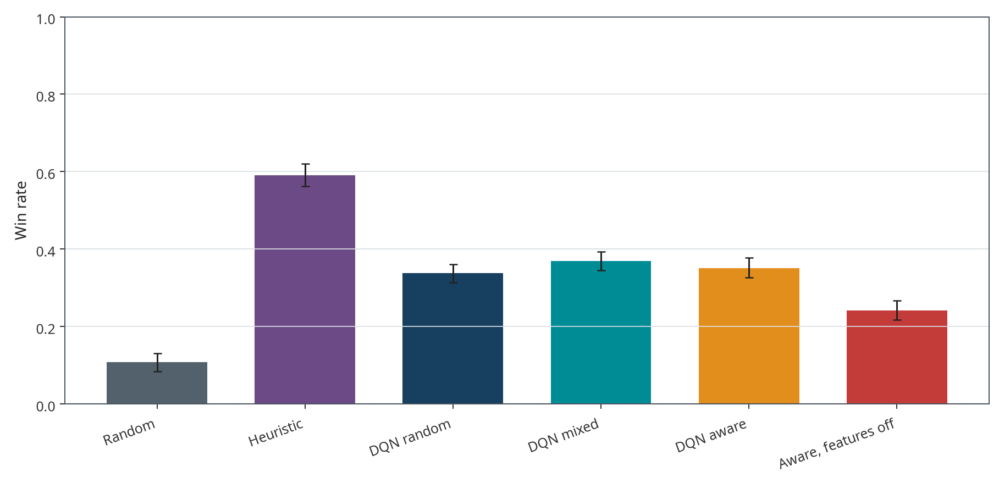
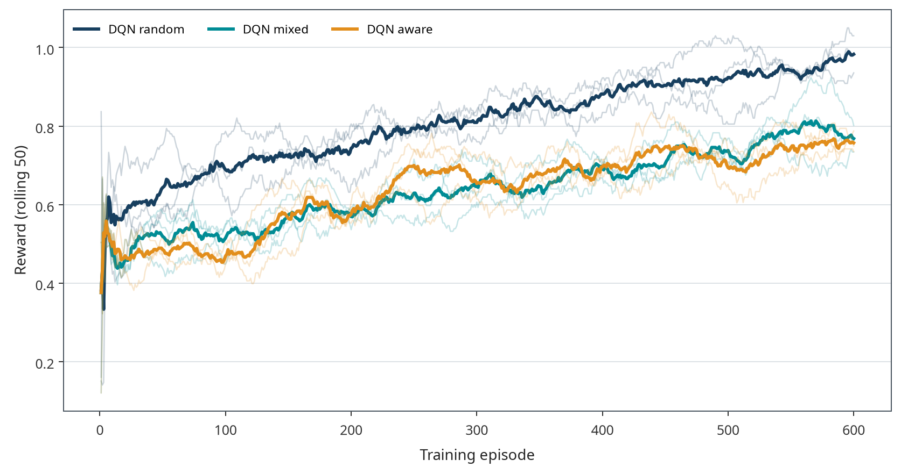

# Opponent-Aware Deep Reinforcement Learning in Chef’s Hat

**7043SCN — Task 2**  
Student: **Sampath Adimalla** · ID: **17522555**  
Assigned variant: `17522555 % 7 = 1` — **Opponent Modelling**

This AI-assisted, reproducible project implements and evaluates masked Double DQN in the official Chef’s Hat `Game` engine. It compares random and heuristic baselines with random-trained, mixed-trained and opponent-aware DQN, plus a same-checkpoint feature-off ablation. Every reported performance value comes from an executed game, not a fabricated, synthetic or filled-in experiment result.

**Status:** all nine final training runs and 8,960 final held-out matches completed; 21 project tests passed; the result verifier passed; the review notebook executed. A reproducible source and final-results repository is provided; the separate original development bundle is retained offline. **The student’s assessed viva recording is still to be added.** Follow [publishing instructions](docs/PUBLISHING.md) and the [recording guide](viva/RECORDING_GUIDE.md), then verify assessor access before submission.

## Start here

Read [the generated results/protocol report](RESULTS.md), [algorithm explanation](docs/ALGORITHM.md), [fixed protocol](docs/EXPERIMENT_PROTOCOL.md), and [limitations](docs/LIMITATIONS.md). Open [the executed review notebook](notebooks/project_review.ipynb). The `viva/` folder contains preparation materials and genuine trained-agent terminal-output evidence; it does not contain a fabricated student recording or video link.

## Measured overall performance

The table gives equally weighted results across random, aggressive, conservative, mixed and switching opponents. Points are official 3–0 finishing points, and a lower finishing position is better. Primary 95% intervals use 3,000 deterministic bootstrap replicates of the 32 shared deal-seed blocks, retaining all four seats, trained checkpoints and opponent conditions together.

| Agent | Matches | Win rate | 95% block-bootstrap interval | Mean points | Mean position |
|---|---:|---:|---:|---:|---:|
| Random | 640 | 10.78% | 8.44–13.12% | 0.891 | 3.109 |
| Heuristic | 640 | 59.06% | 56.25–62.03% | 2.297 | 1.703 |
| DQN-Random | 1,920 | 33.80% | 31.41–36.09% | 1.679 | 2.321 |
| DQN-Mixed | 1,920 | 36.93% | 34.53–39.27% | 1.786 | 2.214 |
| DQN-Opponent-Aware | 1,920 | 35.10% | 32.71–37.76% | 1.721 | 2.279 |
| Aware checkpoint, features off | 1,920 | 24.22% | 21.72–26.72% | 1.466 | 2.534 |

The heuristic remains the strongest observed policy. Opponent-aware DQN does **not** establish an improvement over independently trained DQN-Mixed: its paired win-rate difference is **−1.82 percentage points**, with a 95% shared-deal bootstrap interval of **[−4.74, +1.09] points**. Relative to DQN-Random the difference is **+1.30 points**, interval **[−1.77, +4.32]**. Neither supports a general superiority claim.

Zeroing the aware checkpoints’ behaviour inputs lowers performance by **10.89 percentage points**, paired interval **[8.28, 13.28]**. This supports input reliance but also introduces distribution shift; it is not equivalent to independently retraining without features. Against genuinely switching opponents, DQN-Mixed and DQN-Aware both win **17.19%**, while DQN-Random wins **17.45%**. There is no clear non-stationary adaptation advantage in this test.



## What was trained and evaluated

All DQN conditions use the same **64 → 128 → 128 → 200** ReLU network, with **50,632 parameters**, legal action masking, replay, Huber loss, an online and target network, hard target updates, and epsilon decay. Bootstrap selection is masked too. Published compact checkpoints retain model, target, optimiser, counters and RNG state, but omit experience replay; see [checkpoint format](docs/CHECKPOINT_FORMAT.md). Full replay-bearing originals remain in the student’s local evidence archive for exact resumption.

DQN-Random trains against three random opponents. DQN-Mixed uses one random, one aggressive and one conservative opponent, with their seat order rotated. DQN-Aware uses the exact same mixed schedule with fifteen public behaviour statistics active. Non-aware variants retain the same dimension and zero those fifteen inputs. No opponent private-card identity enters learner observations. A dedicated regression test changes hidden card identities while preserving public hand sizes and confirms identical learner encoding.

Each condition completed **600 matches** at seeds **17, 29 and 43**, giving **5,400 training matches** and **114,208 learner decisions**. Final checkpoints were not selected using test results. The nine measured training durations sum to **548.00 seconds** of per-run wall time; parallel execution means this is not total elapsed pipeline time. Exact individual times and software/hardware are recorded in metadata.

Each frozen checkpoint and baseline faces **32 common held-out deal seeds × four learner seats × five opponent conditions**. Each learned condition has 1,920 evaluation matches; each untrained baseline is evaluated once for 640, not duplicated across training seeds. Adding the 1,920-match feature-off ablation gives **8,960 final matches**, all complete with **zero invalid actions**. CSVs also contain mean-action, pass, duration, rounds and finishing metrics.



Training reward includes `0.01 × cards_discarded` plus delayed official finishing points divided by three. Evaluation uses unshaped outcomes and no exploration or learning. Improving reward/loss does not by itself establish better held-out gameplay.

## Exact environment provenance — important

The backend is official `Game` at commit **`bf882e55eccd537d189f8b99fef1ad104339c92b`**, plus the explicitly saved [one-line two-joker patch](docs/upstream_joker_fix.patch). The patch changes the joker-only empty-board condition from `jokers == 1` to `jokers >= 1`, allowing the existing `C0;Q0;J1` action when two jokers are held. The catalogue remains **200 actions**. [Provenance](docs/environment_provenance.json) records exact source/patch hashes. This is not described as the untouched upstream environment.

Every policy also shares an independent **progress choice constraint**: when an empty board has a legal discard, it does not select pass. Original engine legality remains separate; the guard never adds an illegal action or substitutes an action after execution. The random baseline is uniform over this constrained legal subset. Results are conditional on both choices, not directly comparable with unrestricted unpatched experiments.

See [compatibility findings](docs/ENVIRONMENT_COMPATIBILITY.md), [pass-loop diagnosis](docs/PASS_LOOP_DIAGNOSIS.md), [two-joker diagnosis and fair restart](docs/TWO_JOKER_FIX.md), and [switching event-hook validation](docs/SWITCHING_VALIDATION.md). All pre-patch training and misconfigured switching evaluations are preserved separately and excluded from final aggregation. Main experiments are single-match games; multi-match exchange/role progression is separately tested, not claimed as a fully evaluated long competition.

Upstream Flit installation fails in the pinned revision; the bootstrap retrieves and imports external source, rather than redistributing upstream source/assets. Optional legacy TensorFlow agents are not used. The supplied restricted assignment document is not bundled.

## Install and reproduce

Use Python 3.10+ and Git. From the repository root:

```bash
python -m venv .venv
source .venv/bin/activate
python -m pip install --upgrade pip
python -m pip install -e .
python -m pip install pytest websockets==15.0.1
python scripts/install_environment.py
python -m pytest -q
python scripts/verify_results.py
```

For the notebook builder, also install `requirements-notebook.txt`. See [full reproduction instructions](docs/REPRODUCIBILITY.md), `pyproject.toml` for portable dependency bounds, `requirements.txt` for observed versions, and `docs/hardware_software.json` for the measured stack. PyTorch CPU wheel availability can vary by architecture.

### Inspect existing results without retraining

```bash
python -m sampath_rl.analysis
python scripts/verify_results.py
python scripts/demo.py --checkpoint checkpoints/dqn_aware_seed17.pt --seed 777888 --seat 0
```

The fixed demonstration seed was specified before final evaluation and was not selected from favourable outcomes. The genuine saved match completed in first place with three points and fifteen learner decisions. A single win is not evidence of overall superiority. The transcript, learner/public JSONL trace, final summary and playable asciicast are in `viva/gameplay/`. The asciicast captures actual process output, not a student or GUI gameplay video.

### Fresh runs and authentic resumption

Saved experiments are never silently overwritten. Move the delivered `results/training`, `results/evaluation` and `checkpoints/*.pt` to an archive before a fresh full run:

```bash
python scripts/run_all.py --config configs/standard.yaml --workers 3
python -m sampath_rl.analysis
python scripts/verify_results.py
```

A quick smoke pipeline uses `configs/quick.yaml`; move existing quick outputs aside first. To resume an interrupted final training run with the identical config:

```bash
python scripts/train.py --config configs/standard.yaml --condition dqn_aware --seed 17 --resume
```

Only load trusted, self-created checkpoints: resumable PyTorch files include pickle-based state. No GPU, paid AI model API or secret credential is needed for training or evaluation.

## Repository map

```text
src/sampath_rl/     official adapter, agents, progress policy, experiments, analysis
scripts/           pinned installer, train/evaluate/run_all, verify, demo, notebook
configs/           quick and standard fixed configurations
checkpoints/       nine compact final evaluation checkpoints (replay removed)
results/training/  match rewards, losses and actual completed-run metadata
results/evaluation/ final match-level CSVs, including feature-off ablation
results/summaries/ overall/opponent/seed summaries and paired contrasts
results/figures/   eight PNG+SVG plots and traceable figure_data.json
notebooks/         executed project_review.ipynb
viva/              deck/script preparation and real gameplay evidence
/docs/             algorithm, protocol, reproducibility, provenance, diagnostics
```

## Submission and integrity

This is a **Task 2** implementation package, not a fabricated Task 1 IEEE paper or historical milestone record. Git commits use actual current development dates and identify AI assistance; no development history is backdated. Unit-test fixtures may be synthetic by design, but experiment-result files are not.

Before submitting, inspect and understand the code, comply with your university’s AI-assistance rules, record your own **3–5 minute viva**, upload it to an approved platform, add its real accessible link, publish using your authorised GitHub account, and verify assessor access. No GitHub or recording URL is invented. See [publishing steps](docs/PUBLISHING.md), [recording guide](viva/RECORDING_GUIDE.md) and [submission checklist](SUBMISSION_CHECKLIST.md).
